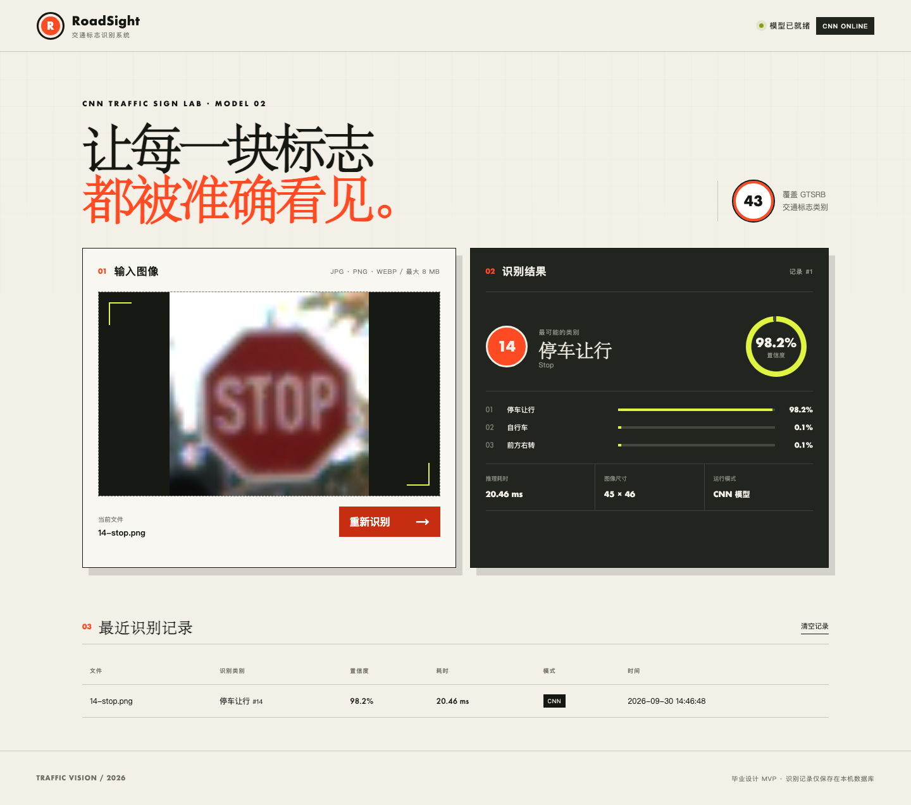

# 基于卷积神经网络的交通标志识别系统

一个面向毕业设计的端到端交通标志分类系统。项目包含 GTSRB 数据处理、CNN 训练与评估、模型推理 API、响应式 Web 界面、SQLite 识别历史，以及可直接上传的43类验证样例。

> 当前模型在 GTSRB 官方独立测试集的 12,630 张图片上取得 **98.47% Accuracy** 和 **0.9744 Macro-F1**。



## 项目亮点

- 覆盖 GTSRB 全部43类交通标志，提供中英文类别名称
- 自研轻量 CNN，包含三段卷积、BatchNorm、Dropout 和空间特征分类头
- 使用旋转、平移、缩放、亮度和对比度增强，不使用会改变标志语义的水平翻转
- 支持图片拖拽上传、Top-3预测、置信度、图像尺寸和推理耗时展示
- 置信度低于55%时主动提示重新裁剪，避免把不确定结果包装成可靠答案
- 使用 SQLite 保存识别历史，提供查询和清空接口
- 权重缺失或 PyTorch 不可用时自动进入明确标注的演示模式
- 提供 API 自动测试、真实浏览器端到端测试和43类高置信度样例

## 技术栈

| 模块 | 技术 |
|---|---|
| 深度学习 | PyTorch、Torchvision |
| 数据集 | GTSRB（43类） |
| 图像处理 | Pillow、NumPy |
| 后端 | FastAPI、Uvicorn |
| 前端 | HTML、CSS、原生 JavaScript |
| 数据库 | SQLite |
| 测试 | Pytest、HTTPX、Playwright |

## 模型指标

| 指标 | 结果 |
|---|---:|
| 官方测试集样本数 | 12,630 |
| Accuracy | 98.47% |
| Macro-F1 | 0.9744 |
| 最佳训练轮次 | 12 |
| 参数量 | 824,011 |
| 权重大小 | 约3.2 MB |

完整训练历史、逐类别召回率和混淆矩阵数据见 [`reports/training_report.json`](reports/training_report.json)。

## 系统架构

```text
浏览器上传图片
      │
      ▼
FastAPI 文件校验 ──► Pillow 解码与归一化
      │
      ▼
TrafficSignCNN 推理 ──► Top-3、置信度、耗时
      │
      ├──────────────► SQLite 识别历史
      │
      ▼
响应式网页展示结果
```

## 快速启动

### 1. 克隆项目

```bash
git clone https://github.com/Lyh2422/TrafficSignRecognition_CNN.git
cd TrafficSignRecognition_CNN
```

### 2. 创建虚拟环境

推荐使用 Python 3.11 或更高版本。

```bash
python3 -m venv .venv
source .venv/bin/activate
```

Windows PowerShell：

```powershell
.venv\Scripts\Activate.ps1
```

### 3. 安装真实模型依赖

```bash
pip install -r requirements-ml.txt
```

仓库已经包含训练权重 `models/gtsrb_cnn.pt`，无需重新训练即可运行真实 CNN。

### 4. 启动系统

```bash
uvicorn app.main:app --reload
```

- 系统页面：<http://127.0.0.1:8000>
- Swagger 接口文档：<http://127.0.0.1:8000/docs>
- 健康检查：<http://127.0.0.1:8000/api/health>

页面右上角显示 `CNN ONLINE` 即表示真实权重加载成功。如果显示 `DEMO MODE`，请检查 PyTorch 是否安装以及权重文件是否存在。

## 如何测试识别

`sample_images/` 包含从官方测试集中筛选的43张 PNG 图片，每类一张，且当前模型均预测正确。可以直接将图片拖入网页：

- `02-speed-limit-50-km-h.png`：限速50
- `14-stop.png`：停车让行
- `17-no-entry.png`：禁止驶入
- `25-road-work.png`：道路施工
- `40-roundabout-mandatory.png`：环岛行驶

完整映射和预期置信度见 [`sample_images/manifest.json`](sample_images/manifest.json)。

适合的输入应满足：

- 图片中只有一个交通标志
- 标志已经裁剪并位于画面中央
- 标志主体约占画面60%～90%
- 图像清晰、没有大面积无关背景
- 类别属于 GTSRB 的43个类别

## 重新训练模型

安装机器学习依赖后执行：

```bash
python -m scripts.train --epochs 18 --batch-size 256 --device auto
```

训练脚本会自动：

1. 下载并校验 GTSRB 训练集和测试集；
2. 按固定随机种子划分训练集与验证集；
3. 应用不会改变标志语义的数据增强；
4. 使用 AdamW、OneCycle 学习率和 Label Smoothing 训练；
5. 按验证准确率保存最佳权重；
6. 在官方测试集上计算 Accuracy、Macro-F1、逐类别召回率和混淆矩阵。

生成文件：

```text
models/gtsrb_cnn.pt
reports/training_report.json
reports/training_history.csv
```

设备参数支持 `auto`、`mps`、`cuda` 和 `cpu`。也可以通过环境变量加载其他权重：

```bash
TSR_MODEL_PATH=/absolute/path/to/model.pt uvicorn app.main:app --reload
```

## API

| 方法 | 路径 | 说明 |
|---|---|---|
| `GET` | `/api/health` | 查看服务、模型模式和类别数量 |
| `POST` | `/api/predict` | 上传图片并返回 Top-3 预测 |
| `GET` | `/api/history?limit=20` | 查询最近识别记录 |
| `DELETE` | `/api/history` | 清空识别历史 |

上传示例：

```bash
curl -X POST http://127.0.0.1:8000/api/predict \
  -F "file=@sample_images/14-stop.png"
```

## 自动测试

```bash
pip install -r requirements-dev.txt
pytest -q
```

浏览器端到端测试：

终端一：

```bash
playwright install chromium
TSR_DB_PATH=.artifacts/browser-smoke.db uvicorn app.main:app --port 8000
```

终端二：

```bash
python tests/browser_smoke.py
```

## 目录结构

```text
├── app/
│   ├── main.py              # FastAPI 路由与文件校验
│   ├── model.py             # CNN 网络结构
│   ├── predictor.py         # 图像预处理与模型推理
│   ├── database.py          # SQLite 识别历史
│   └── labels.py            # GTSRB 43类中英文标签
├── scripts/
│   ├── train.py             # 训练、验证和官方测试
│   ├── evaluate.py          # 独立模型评估
│   └── export_test_samples.py
├── static/                  # Web 页面、样式和交互
├── sample_images/           # 43类可上传测试图片
├── models/gtsrb_cnn.pt      # 最佳模型权重
├── reports/                 # 训练历史与评估结果
└── tests/                   # API 与浏览器测试
```

## 项目边界

当前系统解决的是**交通标志分类**：输入应是已经裁剪好的单个标志。

它暂不负责从完整道路场景中定位交通标志。如果输入整张道路照片、画面包含多个标志，或者使用 GTSRB 之外的中国特有标志，结果可能不可靠。完整道路场景需要在分类模型前增加 YOLO 等目标检测模块。

## 后续计划

- 在网页中展示训练曲线、混淆矩阵和逐类别指标
- 针对“行人”“路面颠簸”等低召回类别进行定向增强
- 增加基础 CNN、MobileNetV3 等模型对比实验
- 增加交通标志检测模块，支持完整道路图片和视频

## 数据集与参考

- [German Traffic Sign Recognition Benchmark](https://benchmark.ini.rub.de/gtsrb_dataset.html)
- [Torchvision GTSRB Dataset](https://docs.pytorch.org/vision/stable/generated/torchvision.datasets.GTSRB.html)
- [PyTorch MPS Backend](https://docs.pytorch.org/docs/stable/notes/mps.html)
